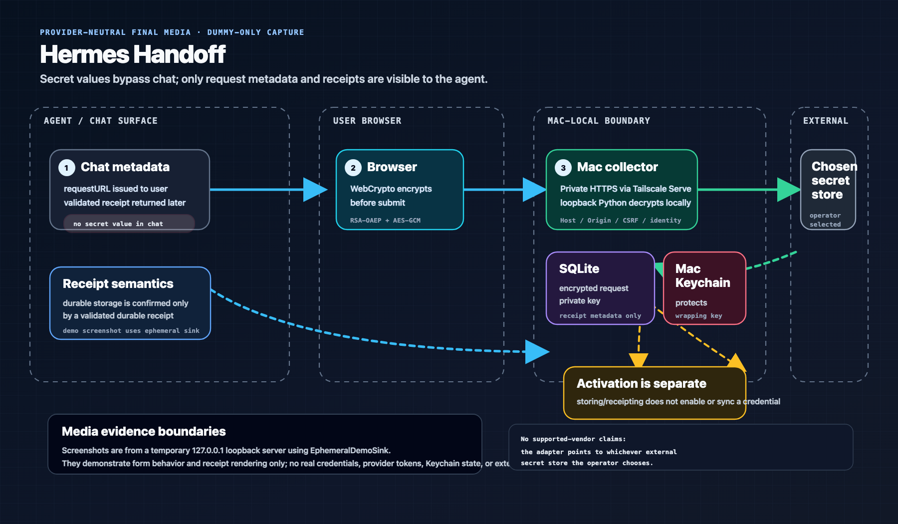
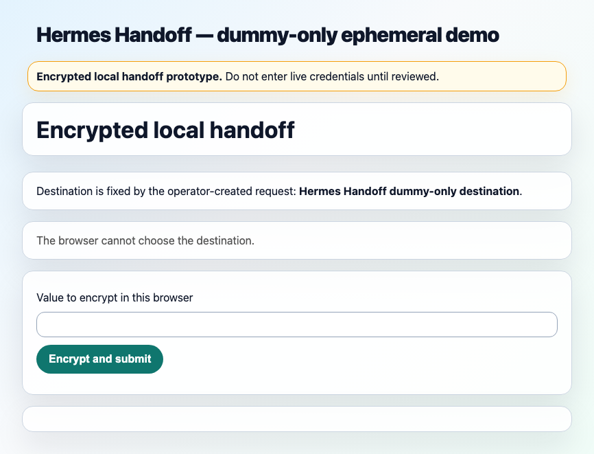
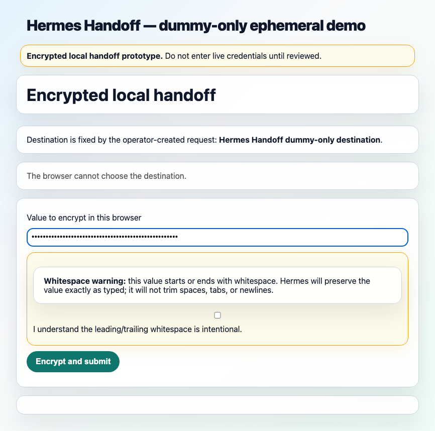
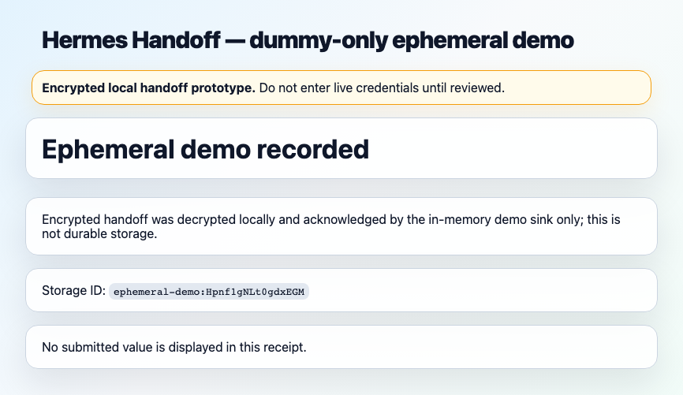

# Hermes Handoff

**Give your agent the credential — not your chat history.**

Hermes Handoff is an independent community prototype for short-lived, browser-assisted credential handoff to a local Mac operator process. It demonstrates a safer pattern for collecting a secret into an approved local secret sink without pasting that secret into an AI chat transcript.

This repository is not an official Nous Research or Hermes Agent product, and it is not endorsed, maintained, or supported by Nous Research.

## Public release status

This code is prepared as a standalone runnable repo with a provider-neutral core. The public candidate does not include a built-in durable secret-provider integration. Durable storage is supplied by the operator through an explicit `--sink module:Class` adapter; the included browser canary uses an ephemeral in-memory demo sink only.

Do not treat the proposed MIT license for original code as clearance for Tailscale, Hermes Agent, operator-supplied sink adapters, or any other third-party dependency.

## What is included

- `secure_storage/`: local Python package for request creation, loopback HTTP collection, request registry/state, browser WebCrypto envelope handling, macOS Keychain key protection, and provider-neutral durable-sink interfaces.
- Offline unit/integration tests using fake sinks and temporary state only.
- A synthetic browser demo canary that submits a generated non-secret value through the local encrypted handoff flow.
- Template-only Mac hosted deployment notes under `deploy/mac-hosted/` using sample hostnames, sample UUIDs, and placeholder operator identity.

## Security model, briefly



### Actual demo screenshots

These captures use synthetic data and an ephemeral sink, not a real vault.







The browser receives a short-lived one-use handoff URL. Browser JavaScript encrypts the submitted value with WebCrypto, wraps the AES key to a Mac-generated RSA public key, and posts only the encrypted envelope. The local Mac collector unwraps/decrypts and passes the plaintext to an injected sink. Durable storage is intentionally operator-supplied via `--sink module:Class`; offline tests and the browser canary use fake or ephemeral sinks only.

## Security limitations

- Prototype/publication candidate, not audited production software.
- The served JavaScript must be trusted. A compromised page delivery path can exfiltrate the value before encryption; ciphertext relay is not a malicious-server secrecy proof.
- Same-user local processes are inside the trust boundary. A local process that steals a bearer URL/cookies or can spoof the local proxy path can interfere.
- Tailscale Serve/private HTTPS examples trust the local identity proxy to supply correct `Tailscale-User-Login` headers.
- Do not enter real credentials until you have reviewed and adapted the threat model, destination project isolation, service lifecycle, logging, dependency licenses, and recovery behavior for your environment.

## Quickstart: clean standalone install

Requires Python 3.12+ and no private Hermes source tree.

```bash
cd hermes-credential-handoff
python3 -m venv .venv
. .venv/bin/activate
python -m pip install --upgrade pip
python -m pip install -r requirements.txt
python -m playwright install chromium
```

Run the offline test suite:

```bash
PYTHONDONTWRITEBYTECODE=1 python -m unittest discover -v
```

Run the synthetic browser demo canary (fake sink, generated non-secret value, temp/isolated state):

```bash
python -m secure_storage.run_browser_canary \
  --protected-test-memory \
  --evidence-dir /tmp/hermes-handoff-demo
```

Expected output is JSON like:

```json
{"ok": true, "mode": "ephemeral-demo", "receipt_path": "/tmp/hermes-handoff-demo/browser-canary-demo-....json", "log_path": "/tmp/hermes-handoff-demo/browser-canary-demo-....log"}
```

The demo starts an ephemeral loopback server and a local Chromium browser. Its sink is in-memory and not durable. It does not call a secret provider, read live credentials, or write Keychain.

## CI

GitHub Actions workflow: `.github/workflows/offline-tests.yml`

It installs `requirements.txt`, installs Playwright Chromium, runs the offline unit/integration tests, and runs the provider-free synthetic browser demo. It does not install a secret-provider SDK or require secrets.

## Durable sink configuration

The public core is provider-neutral. To serve real handoffs, the operator must supply a durable sink adapter and pass it explicitly as `--sink module:Class` to `secure_storage.production serve`. The adapter class must be importable in the runtime environment, require no secrets from environment variables in its zero-argument constructor, expose `durable = True`, and implement the `DurableSink.store(destination, value, request_id=...)` contract from `secure_storage.sinks`.

Browser clients cannot choose the destination. Request creation binds `--destination-label` locally, with optional `--destination-id` if the operator adapter needs a stable opaque destination identifier.

Example protected request creation:

```bash
python -m secure_storage.production create \
  --state ~/.hermes/hermes-handoff/secure-handoff.sqlite3 \
  --origin https://handoff-mac.example-tailnet.ts.net:9443 \
  --allowed-origin https://handoff-mac.example-tailnet.ts.net:9443 \
  --destination-label REVIEWED_DESTINATION_NAME \
  --ttl-seconds 300
```

Example protected collector startup with an operator-supplied durable adapter:

```bash
python -m secure_storage.production serve \
  --state ~/.hermes/hermes-handoff/secure-handoff.sqlite3 \
  --host 127.0.0.1 \
  --port 9127 \
  --external-origin https://handoff-mac.example-tailnet.ts.net:9443 \
  --allowed-origin https://handoff-mac.example-tailnet.ts.net:9443 \
  --tailscale-user-login operator@example.com \
  --sink your_package.your_sink:YourDurableSink \
  --log ~/.hermes/hermes-handoff/secure-handoff.log
```

For local demonstrations only, `secure_storage.production serve --allow-ephemeral-demo-sink` uses non-durable in-memory storage and must not be treated as real secret storage.

## Sample placeholder values

Checked-in docs/tests use coherent placeholders only:

- Origin: `https://handoff-mac.example-tailnet.ts.net:9443`
- Operator identity: `operator@example.com`
- Example destination ID: `11111111-1111-4111-8111-111111111111`

Replace placeholders with private values outside git when deploying.
